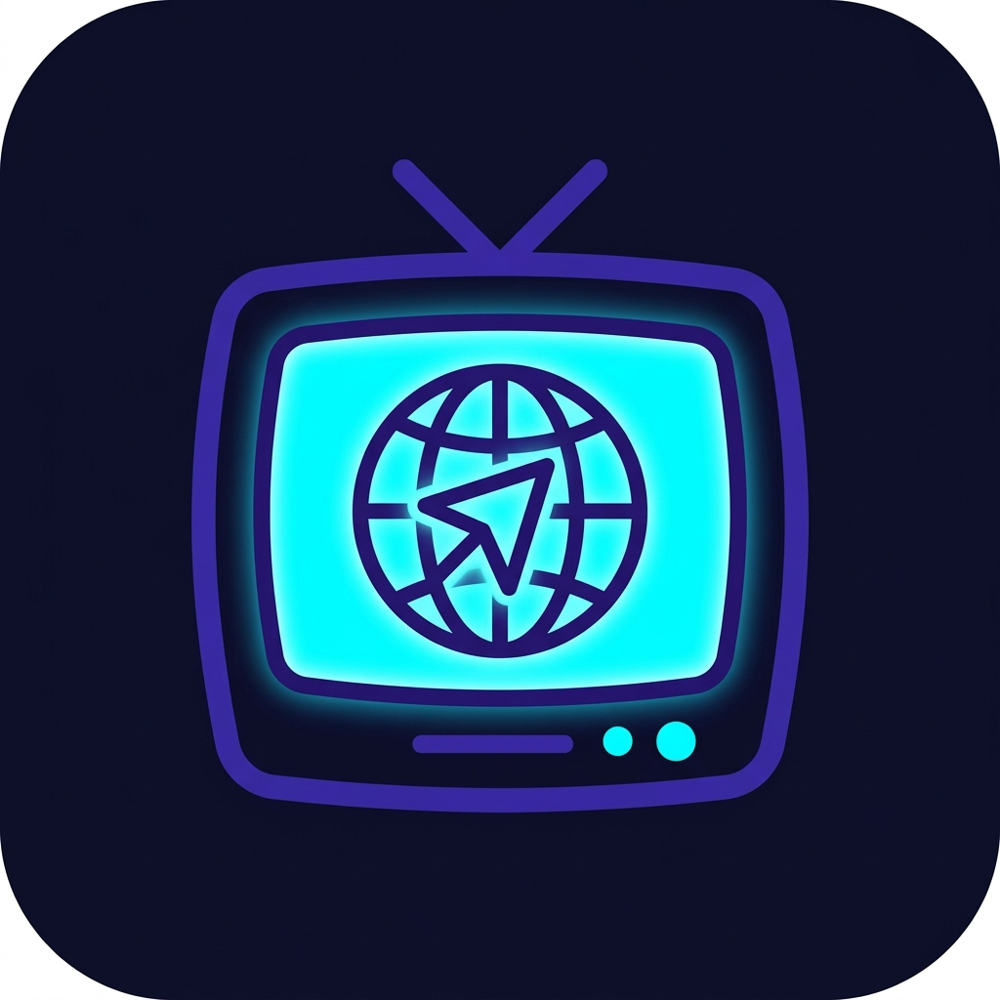
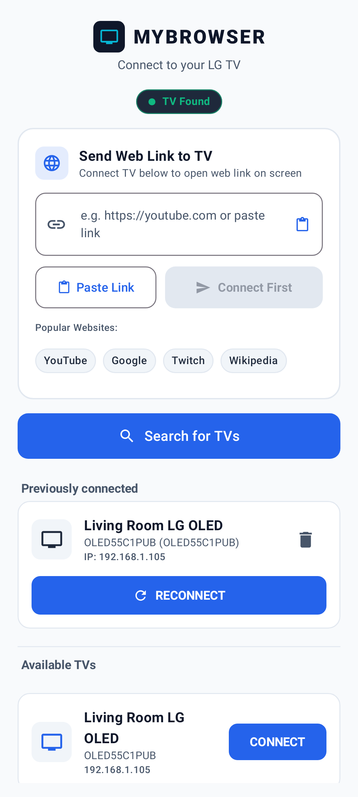
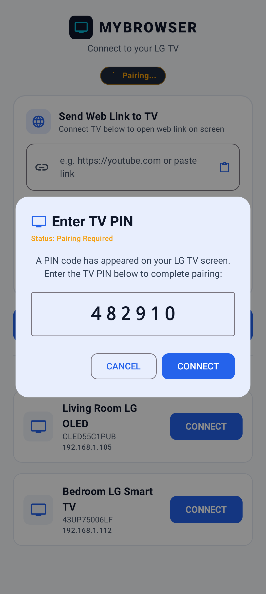
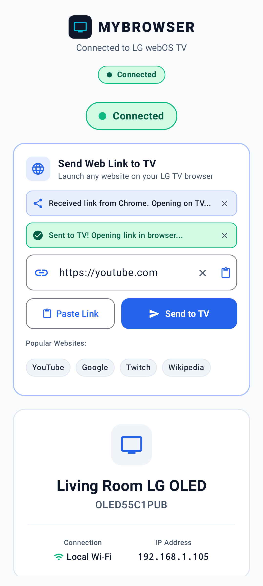

<div align="center">



# mybrowser

**An Android companion app for LG webOS TVs built with Kotlin, Jetpack Compose, and Connect SDK — featuring automatic Wi-Fi TV discovery, multi-mode pairing, Android Share Sheet casting from Chrome, and manual URL sending.**

<p>
  <a href="https://drive.google.com/file/d/1Su5Ua5eOZ-k8A0WJoR4mnQpBQ5qhaAU1/view?usp=drive_link">
    
  </a>
  
  
  
</p>

[Download APK](https://drive.google.com/file/d/1Su5Ua5eOZ-k8A0WJoR4mnQpBQ5qhaAU1/view?usp=drive_link) · [Screenshots](#screenshots) · [Features](#core-features) · [Architecture](#reactive-connection-state-architecture) · [Getting Started](#getting-started--running-tests)

</div>

---

## Download & Install APK

Click the button below to download the latest Android APK directly from Google Drive:

<div align="center">

[](https://drive.google.com/file/d/1Su5Ua5eOZ-k8A0WJoR4mnQpBQ5qhaAU1/view?usp=drive_link)

</div>

> **Direct Link:** [`https://drive.google.com/file/d/1Su5Ua5eOZ-k8A0WJoR4mnQpBQ5qhaAU1/view?usp=drive_link`](https://drive.google.com/file/d/1Su5Ua5eOZ-k8A0WJoR4mnQpBQ5qhaAU1/view?usp=drive_link)
>
> *Installation tip:* After downloading the `.apk` on your Android phone, open it and allow **"Install unknown apps"** when prompted by Android.

---

## Screenshots

<div align="center">

| TV Discovery & Manual Link Input | PIN / Prompt TV Pairing | Connected & Chrome Share Casting |
| :---: | :---: | :---: |
|  |  |  |

</div>

---

## Overview & Purpose

**mybrowser** turns your Android phone into a fast, frictionless web-link companion for your **LG Smart TV (webOS & Netcast)**.

Instead of typing long URLs with a TV remote or on-screen keyboard, mybrowser lets you **share any webpage directly from Google Chrome** (or any Android app) straight to your TV's browser, or **paste and send links manually** from a clean Material 3 interface.

Key capabilities include:
- **Automatic SSDP Wi-Fi TV Discovery** with live Wi-Fi connectivity monitoring and `MulticastLock` management
- **Reactive `ConnectionState` Architecture** powered by a Kotlin `sealed class` and `StateFlow` in `TvCompanionViewModel`
- **Multi-Mode LG TV Pairing** supporting On-Screen Prompt, TV PIN Entry, and Combined modes, plus saved device reconnection
- **Chrome & System Share Sheet Integration** via `ACTION_SEND` and `ACTION_VIEW` intent filters on a `singleTask` `MainActivity`
- **In-App Manual Link Sender (`SendWebLinkCard`)** with one-tap clipboard paste, URL extraction/formatting, quick website chips, and live delivery feedback

---

## Reactive Connection State Architecture

mybrowser models the entire TV lifecycle through a type-safe Kotlin `sealed class` (`ConnectionState`) synchronized from `TvCompanionUiState` and exposed via `StateFlow` in `TvCompanionViewModel`:

| State | `displayText` | Payload | UI Behavior |
| :--- | :--- | :--- | :--- |
| **`ConnectionState.Searching`** | `"Searching..."` | — | Animated scanning badge & SSDP discovery indicator |
| **`ConnectionState.Discovered`** | `"TV Found"` | `devices: List<TvDevice>` | Renders discovered LG TVs with one-tap `CONNECT` cards |
| **`ConnectionState.Pairing`** | `"Pairing..."` | `device`, `mode`, `pairingType` | Displays `PairingDialog` adapted to `PROMPT`, `PIN`, or `COMBINED` |
| **`ConnectionState.Connected`** | `"Connected"` | `device: TvDevice` | Switches to `ConnectedView` with active TV metadata & link casting |
| **`ConnectionState.Disconnected`** | `"Disconnected"` | `previouslyPairedDevice` | Shows `DiscoveryAndPairingView` and saved `PairedTvCard` for quick reconnect |

---

## Core Features

### 1. Local Network Discovery & Wi-Fi Resilience
- `ConnectSdkManager` initializes Connect SDK with `PairingLevel.ON` and explicitly registers `WebOSTVService` and `NetcastTVService` over `SSDPDiscoveryProvider` (avoiding legacy FireTV/WhisperLink receivers that crash on Android 14+).
- Acquires a `WifiManager.MulticastLock` during active scans so SSDP packets are received reliably across Android devices.
- Monitors network changes in real time with `ConnectivityManager.NetworkCallback`, surfacing a clear `WifiWarningBanner` whenever Wi-Fi is unavailable.

### 2. Multi-Mode webOS Pairing & Saved TVs
- **Prompt Mode (`WebOsPairingMode.PROMPT`):** Sends a pairing prompt to the TV screen for approval with the TV remote.
- **PIN Mode (`WebOsPairingMode.PIN`):** Displays a numeric monospace PIN field (`tv_pin_input`) to submit the code shown on the TV.
- **Combined Mode (`WebOsPairingMode.COMBINED`):** Lets you either accept on the TV or enter the displayed PIN.
- **Quick Reconnect & Unpair:** Paired TV details (`id`, `friendlyName`, `modelName`, `modelNumber`, `ipAddress`) are persisted in `SharedPreferences` (`mybrowser_tv_prefs`) for one-tap reconnection or forgetting the device.

### 3. Chrome & Android Share Sheet Integration
- `AndroidManifest.xml` registers `ACTION_SEND` (`text/plain`) and `ACTION_VIEW` (`http` / `https`, `BROWSABLE`) intent filters on `MainActivity`.
- `MainActivity` uses `android:launchMode="singleTask"` and handles both `onCreate` and `onNewIntent` so links shared from Google Chrome or tapped elsewhere flow smoothly into the running app without duplicating screens.
- `UrlUtils.extractUrl()` automatically parses clean HTTP/HTTPS URLs out of Chrome's shared text (even when mixed with page titles or descriptions) and prepends `https://` to protocol-less domains.
- **Smart Delivery:**
  - If your TV is already **Connected**, the shared link is launched on the TV immediately.
  - If your TV is **Disconnected**, the link is pre-filled into the input field with a banner prompting you to connect so you can send it right away.

### 4. Manual Link Input & Quick Shortcuts (`SendWebLinkCard`)
- **Manual URL Field:** Type or edit any website URL (`KeyboardType.Uri`, `ImeAction.Send`) with a quick clear button.
- **One-Tap Clipboard Paste:** Tap **Paste Link** (or the inline paste icon) to read from the system clipboard and automatically extract any embedded URL.
- **Instant Browser Launch:** Invokes Connect SDK's `Launcher.launchBrowser()` capability (with a direct `WebOSTVService` fallback) and displays real-time sending, success, and error banners.
- **Popular Website Chips:** Quick-fill chips for **YouTube**, **Google**, **Twitch**, and **Wikipedia**.

---

## Tech Stack & Architecture

- **Language:** Kotlin
- **UI Framework:** Jetpack Compose + Material Design 3 (Edge-to-Edge via `enableEdgeToEdge()`, adaptive width-constrained layout)
- **Architecture:** MVVM (`TvCompanionViewModel` as `AndroidViewModel` + `StateFlow` / `collectAsState`) backed by `ConnectSdkManager`
- **TV Discovery & Control:** Connect SDK (`com.github.ConnectSDK:Connect-SDK-Android:2.0.0`) over SSDP / webOS / Netcast
- **Concurrency:** Kotlin Coroutines (`SupervisorJob` + `Dispatchers.Main` & `viewModelScope`)
- **Testing:**
  - `TvCompanionStateTest`: Unit tests for `ConnectionState` mapping across all statuses, `WebOsPairingMode`, `UrlUtils` URL extraction/formatting, and link feedback state
  - `AppScreenshotsTest`: Roborazzi Compose screenshot tests capturing the Discovery, Pairing, and Connected UI states
  - `ExampleRobolectricTest`: Robolectric test verifying application resource resolution on SDK 36

---

## Project Structure

```text
├── docs/
│   └── images/
│       ├── app_logo.jpg                       # App logo used in README
│       ├── screen_discovery.png               # Discovery & manual link input screenshot
│       ├── screen_pairing.png                 # Pairing dialog screenshot
│       └── screen_connected.png               # Connected & Chrome link cast screenshot
├── gradle/libs.versions.toml                  # Version catalog (Compose, Connect SDK, Coroutines, Robolectric)
└── app/src/
    ├── main/
    │   ├── AndroidManifest.xml                # Wi-Fi/Multicast permissions, singleTask launchMode, SEND & VIEW filters
    │   ├── res/values/strings.xml             # App name ("mybrowser") & string resources
    │   └── java/com/example/
    │       ├── MainActivity.kt                # Edge-to-edge host & Chrome/Share Sheet intent extraction
    │       ├── data/
    │       │   ├── ConnectionState.kt         # Sealed class (Searching, Discovered, Pairing, Connected, Disconnected)
    │       │   ├── TvCompanionUiState.kt      # Unified UI state, ConnectionStatus, WebOsPairingMode & state sync
    │       │   └── TvDevice.kt                # Discovered LG TV model wrapping ConnectableDevice metadata
    │       ├── service/
    │       │   └── ConnectSdkManager.kt       # SSDP discovery, MulticastLock, Wi-Fi monitor, pairing & launchUrlOnTv
    │       ├── ui/
    │       │   ├── MainScreen.kt              # Compose UI: AppHeader, StatusBadge, SendWebLinkCard, PairingDialog, ConnectedView
    │       │   ├── TvCompanionViewModel.kt    # Exposes uiState, connectionState, pinState, linkInputState & actions
    │       │   └── theme/                     # ColorScheme, Typography & Material 3 theme
    │       └── util/
    │           └── UrlUtils.kt                # Regex URL extraction from shared text & https:// formatting
    └── test/java/com/example/
        ├── TvCompanionStateTest.kt            # ConnectionState, pairing modes, UrlUtils & link state unit tests
        ├── AppScreenshotsTest.kt              # Roborazzi UI screenshot generator for README
        └── ExampleRobolectricTest.kt          # Robolectric app context & resource verification
```

---

## Getting Started & Running Tests

### Prerequisites
- Android phone and LG webOS (or Netcast) Smart TV connected to the **same local Wi-Fi network**
- **LG Connect Apps** enabled on your LG TV (if prompted in TV Network Settings)

### 1. Build the Android App
```bash
gradle assembleDebug
```

### 2. Run Unit & Robolectric Tests
```bash
gradle :app:testDebugUnitTest
```

Run only the state & URL utility test suite:
```bash
gradle :app:testDebugUnitTest --tests 'com.example.TvCompanionStateTest'
```

### 3. Regenerate UI Screenshots
```bash
gradle :app:recordRoborazziDebug --tests 'com.example.AppScreenshotsTest'
```

---

## How to Use

### Connecting to Your LG TV
1. Launch **mybrowser** — SSDP scanning starts automatically on your local Wi-Fi network (or tap **Search for TVs**).
2. Tap **CONNECT** next to your LG TV (or **RECONNECT** on your previously paired TV card).
3. Approve the connection prompt on your TV with the remote, or enter the PIN displayed on the TV screen.

### Sending Links from Chrome (Share Sheet)
1. Open any webpage in **Google Chrome** on your phone.
2. Tap the **Share** menu (`⋮` → **Share...**).
3. Select **mybrowser** from the Android Share Sheet — if your TV is connected, the page opens automatically on your TV browser.

### Sending Links Manually Inside the App
1. Enter or paste a URL in the **Send Web Link to TV** field (or tap **Paste Link** / a **Popular Websites** chip).
2. Tap **Send to TV** to launch the website directly on your LG TV screen.
